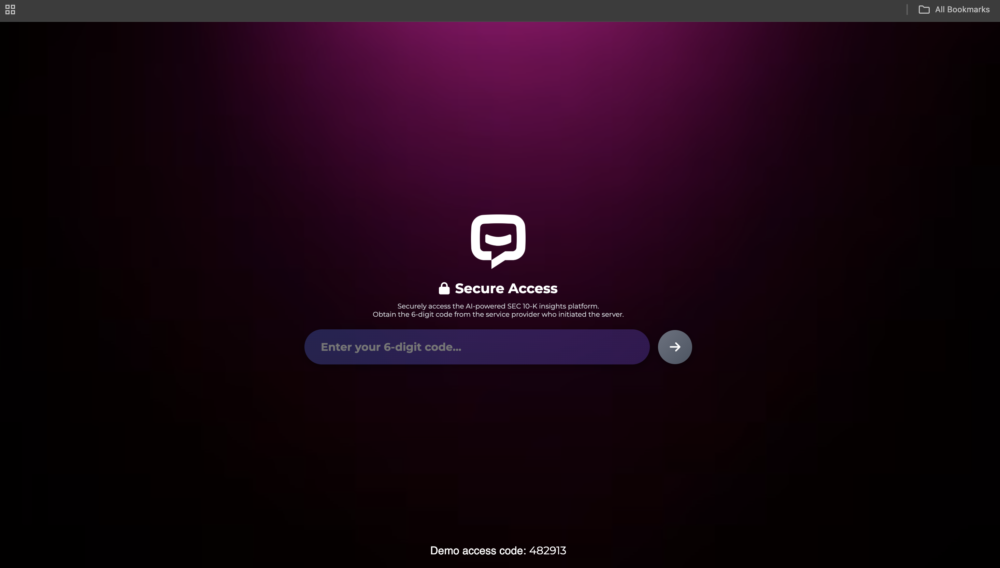
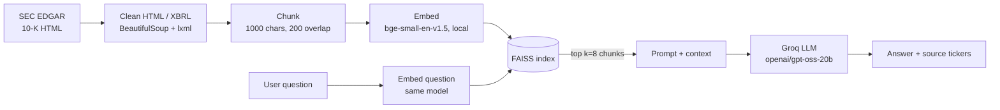

# sec-filings-qa


## Demo

[](https://youtu.be/N576NmwRQnU)

CLICK THE IMAGE ABOVE FOR THE DEMO

A 90-second walkthrough: qualitative question, numeric question, and a refusal on an unanswerable one.

A question-answering web app over the latest SEC 10-K filings of 10 public companies. Ask a question in plain English, and the app retrieves the most relevant passages from the filings and has an LLM answer using only that context.

> **Based on [r0han01/genai-sec10k-insights](https://github.com/r0han01/genai-sec10k-insights) (MIT).**
> I used that project as the starting skeleton and re-engineered the model layer, data pipeline and API. See [What I built vs. what I reused](#what-i-built-vs-what-i-reused) for exact details.

**Status:** runs locally; evaluation is in progress (see [Roadmap](#roadmap)). No accuracy numbers are claimed yet.

---

## What it does

- Downloads the most recent 10-K for **AAPL, MSFT, TSLA, AMZN, JPM, NVDA, WMT, META, KO, PFE** from SEC EDGAR
- Cleans the filings (they are inline-XBRL HTML), splits them into overlapping chunks, and indexes them in FAISS
- Answers questions through a FastAPI backend and a simple chat UI
- Refuses to guess: the prompt instructs the model to say *"The context does not contain the information."* when the retrieved text lacks the answer

Example questions: *"What does Microsoft report about cybersecurity risks?"*, *"What supply chain risks does Apple describe?"*

## Architecture



| Component | Choice |
|---|---|
| Backend | FastAPI, LangChain (loaders/vector store), custom retrieve-then-generate function |
| Embeddings | `BAAI/bge-small-en-v1.5` via sentence-transformers (runs locally, no API key) |
| Vector store | FAISS (6,981 chunks across 10 filings) |
| LLM | Groq-hosted `openai/gpt-oss-20b`, temperature 0 |
| Retrieval | Dense similarity search, k = 8 |
| Frontend | Static HTML/CSS/JS chat page |


| Area | Change |
|---|---|
| Models | Replaced OpenAI embeddings and GPT-3.5 with **local `bge-small` embeddings** and a **free Groq-hosted LLM**, so the project runs without a paid API key. Rebuilt the index (embedding dimensions differ: 1536 vs 384). |
| RAG chain | Rewrote `rag_pipeline.py` as an explicit retrieve, format-prompt, generate function, replacing the legacy `RetrievalQA` wrapper that no longer imports on current LangChain. |
| Data cleaning | Added HTML and **inline-XBRL stripping** (`ix:header`, scripts, styles) before chunking. Without it the chunks were mostly markup. |
| Compatibility | Fixed deprecated LangChain imports (`langchain_core`, `langchain_text_splitters`) and a deprecated `.dict()` serialisation call. |
| API hardening | Per-IP **rate limit** (10 requests/minute), 500-character question cap, input validation, and clean JSON error responses so the chat UI no longer crashes when the LLM call fails. |
| Config and security | Secrets and settings via `.env` (git-ignored); fixed or random demo access code; removed a leaked key fragment from a startup banner. |
| Repo hygiene | `.gitignore`, `.env.example`, Git LFS for the FAISS index, credit and license preserved. |

## Quick start

Tested on macOS with Python 3.14. You need internet access (SEC download, first-time model download, Groq API) and a free [Groq API key](https://console.groq.com).

```bash
# 1. Environment
python3 -m venv venv
source venv/bin/activate
pip install -r backend/requirements.txt
pip install sec-downloader beautifulsoup4 lxml langchain-core langchain-text-splitters \
            langchain-huggingface sentence-transformers langchain-groq

# 2. Configuration: copy and fill in
cp .env.example .env        # set GROQ_API_KEY, ACCESS_CODE
cp backend/app/config.example.py backend/app/config.py

# 3. Build the data (run from repo root, in this order)
#    Edit the contact email in download_sec_filings.py first; SEC requires a real one.
python sec_downloader/download_sec_filings.py
python sec_downloader/chunk_text.py
python sec_downloader/embed_and_store.py

# 4. Run
cd backend
uvicorn app.main:app --reload
```

Open `http://localhost:8000`, enter the access code (shown on the login page when `SHOW_CODE=true`, otherwise in the terminal), and ask a question. API docs are at `/docs`.

A pre-built index is included in `data/faiss_index/` (via Git LFS), so step 3 is only needed to refresh the filings.

**Note on the filings:** the downloader fetches the *latest* 10-K at run time. The index in this repo was built on 10 Oct 2026 (for example, Apple's filing covers the fiscal year ended 27 Sep 2025). `notebooks/mock_10k_40_questions.json` comes from the original project and refers to "2023", so questions need rewording to match the filing year before they are used as ground truth.

## Screenshots

_Add one or two screenshots of the chat page answering a question here (`docs/` folder)._

## Known limitations

These are observed or expected weaknesses I plan to measure, not hidden:

- **Tables are flattened to plain text.** Financial figures in HTML tables can end up on separate lines from their labels, which likely hurts numeric questions (for example, "total net sales"). *Hypothesis to be tested in the evaluation.*
- **Citations are ticker-level only.** Chunks carry only the company ticker as metadata, so answers cite "MSFT", not a filing section or page.
- **Cross-company questions are weak.** Retrieval pulls the top 8 chunks across all companies, so a comparison may only retrieve one side.
- **Small model.** `gpt-oss-20b` is chosen for the free tier; larger models may read numbers better.
- **Demo-grade access control.** The access-code gate is a light barrier, not security.
- **Docker.** A `Dockerfile` is included from earlier deployment attempts but has not been verified; the supported way to run is the quick start above.

## Roadmap

- [ ] Verified evaluation set: ~30 questions with ground-truth answers and filing sections, tagged numeric / qualitative / unanswerable, with a dev/test split
- [ ] Baseline score of the current pipeline (answer accuracy, citation correctness, refusal rate on unanswerable questions)
- [ ] Hybrid retrieval (BM25 + vectors) with a reranker, re-scored on the held-out test set
- [ ] Table-aware parsing (keep row label and value together)
- [ ] Section-level citations (e.g. "Item 1A, Risk Factors")
- [ ] Chunk-size and k experiments
- [ ] Public deployment

Results will be added here as a before/after table once the evaluation is run.

## Project structure

```
backend/app/        FastAPI app (main.py), API routes, RAG pipeline
frontend/           Login page and chat UI
sec_downloader/     download, clean+chunk, embed+index scripts
data/faiss_index/   Pre-built FAISS index (Git LFS)
notebooks/          Starter question file from the original project
```
